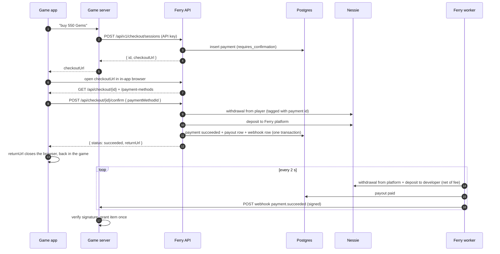
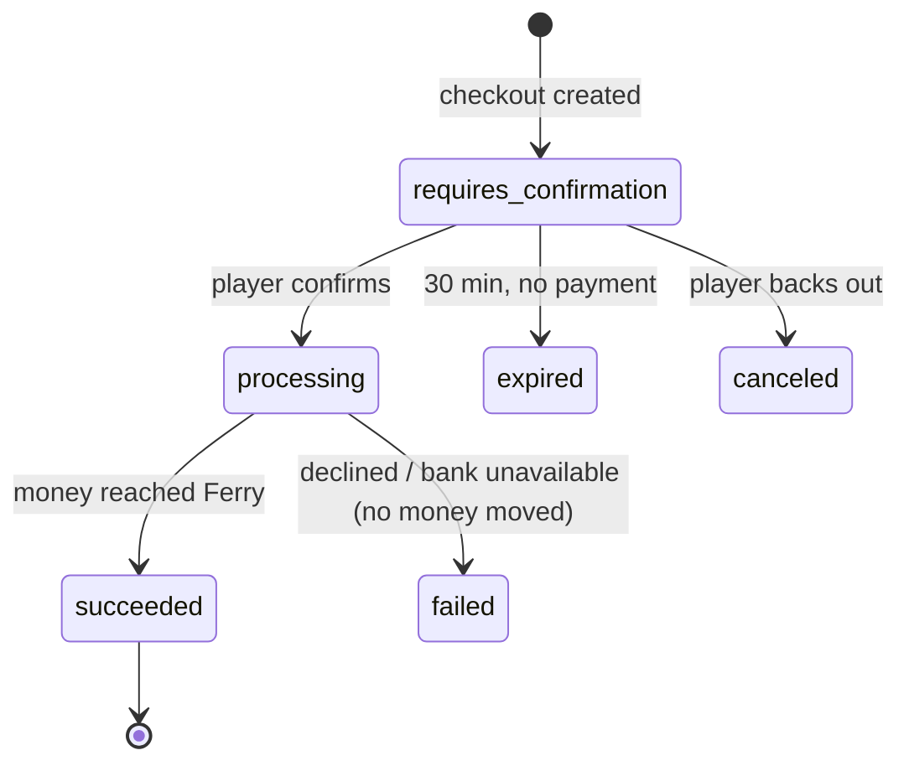

# Ferry

Ferry lets a game sell in-app items through **its own checkout** (opened in an in-app browser) instead
of Apple's In-App Purchase, so developers keep more of each sale. Money moves through **Capital One's
Nessie** — a simulated bank — but Ferry follows real payment-processor practice throughout.

- **Dashboard** — developers sign in (Clerk), create apps and products, manage API keys.
- **Payments API** — what this README explains. Full endpoint reference: [`docs/payments-api.md`](docs/payments-api.md).

```bash
npm install
npm run db:push            # create/update tables in the database
npm run payments:setup     # one-time: Nessie platform account + demo players
npm run dev                # http://localhost:3000 — also starts the payments worker
npm test                   # 29 tests (in-memory Postgres + fake Nessie)
npm run payments:live-test # a real purchase through the HTTP API and Nessie (needs npm run dev)
```

---

## Payments backend: how a purchase flows

### Who talks to whom

| Actor | What it is | How it authenticates to Ferry |
|---|---|---|
| **Game app** | the player's iPhone app | never calls Ferry's money endpoints directly |
| **Game server** | the developer's backend | `Authorization: Bearer sk_test_…` (API key) |
| **Checkout page** | Ferry's purchase screen in the in-app browser | the unguessable payment id in its URL |
| **Ferry** | Next.js API routes + Postgres + a background worker | — |
| **Nessie** | the simulated bank where money moves | Ferry's `NESSIE_API_KEY` (server-side only) |

### The whole flow



### Every HTTP call, in order

**1. Game server → Ferry: start a checkout**
```http
POST /api/v1/checkout/sessions
Authorization: Bearer sk_test_…
{ "productId": "…", "orderId": "order-8812", "playerId": "player-42", "returnUrl": "pixelquest://ferry" }

201 → { "id": "c1b0…", "status": "requires_confirmation", "amountCents": 499, "feeCents": 25,
        "netCents": 474, "checkoutUrl": "https://ferry…/checkout/c1b0…", … }
```
Ferry hashes the key (SHA-256) and finds the app in `api_keys`; reads the **price from the product row**
(never from the request); on the app's first sale creates its Nessie payout account and webhook secret;
returns the existing session if this `orderId` already has one (safe retries); inserts a `payments` row
that expires in 30 minutes.

**2. Checkout page → Ferry: show the purchase**
```http
GET /api/checkout/c1b0…                    → { description, amountCents, merchant: { name }, status, … }
GET /api/checkout/c1b0…/payment-methods    → { data: [{ "id": "pm_160b…", "label": "Demo Player 1" }] }
```
Payment methods are opaque `pm_…` ids — like saved cards. No balances, no account numbers.

**3. Checkout page → Ferry: pay**
```http
POST /api/checkout/c1b0…/confirm
{ "paymentMethodId": "pm_160b…" }

200 → { "status": "succeeded", "returnUrl": "pixelquest://ferry?payment_id=c1b0…&status=succeeded" }
```
Inside one request, Ferry:
1. Maps `pm_…` back to the player's Nessie account (server-side only).
2. Flips the payment to `processing` with a conditional update — a double-click can't confirm twice.
3. Claims a 30-second **lease** on the payment so no other request/worker/server works on it at once.
4. Moves the money in Nessie (below), checking funds privately first.
5. In **one database transaction**: marks the payment `succeeded`, creates a `payouts` row (what's owed to
   the developer) and a `webhook_deliveries` row.

If Nessie is slow or down, the response is `processing`; the page polls `GET /api/checkout/{id}` every
~1 s while the worker retries. When `returnUrl` is non-null the payment is final: the page redirects
there, which closes the in-app browser. **The game must then ask its own server**, not trust the URL.

**4. Ferry → Nessie: how money actually moves**

Nessie has no "transfer A → B" endpoint, returns no ids from create calls, and never updates stored
balances. So every money movement is two calls, each tagged with Ferry's id in its description:

```http
GET  https://api.nessieisreal.com/accounts/{player}/withdrawals?key=…   ← already done? (timeout recovery)
POST https://api.nessieisreal.com/accounts/{player}/withdrawals?key=…
     { "medium": "balance", "amount": 499, "status": "completed", "description": "c1b0… payment order-8812" }
GET  https://api.nessieisreal.com/accounts/{platform}/deposits?key=…
POST https://api.nessieisreal.com/accounts/{platform}/deposits?key=…
     { "medium": "balance", "amount": 499, "status": "completed", "description": "c1b0… payment order-8812" }
```

- **Look before writing:** before each create, Ferry lists the account's records and looks for its tag.
  If a previous attempt timed out *after* Nessie saved it, Ferry finds it instead of charging again.
- **Balance** = opening balance + deposits − withdrawals (computed, since Nessie never updates it).
- **Amounts are cents** (`NESSIE_AMOUNT_UNIT=cents`): Nessie only stores whole numbers.

**5. Worker: developer payout** (every 2 s; or `POST /api/internal/tick` from a cron on serverless hosts)

The same two-call pattern, platform → developer, for the net amount (474), tagged with the payout id.
Retried with backoff on failure — never re-charges the player. The 25¢ fee stays in the platform account.

**6. Ferry → Game server: webhook**
```http
POST https://game.example/ferry-webhook
X-Ferry-Signature: t=1792882108,v1=8f3a…
{ "id": "evt_…", "type": "payment.succeeded", "created": "…", "data": { "payment": { "id": "c1b0…", "orderId": "order-8812", "amountCents": 499, "status": "succeeded", … } } }
```
- `v1 = HMAC-SHA256(webhookSecret, "<t>.<raw body>")`. The game server verifies it (rejecting anything
  older than 5 minutes), then **grants the item once** — webhooks can repeat.
- Any `2xx` = delivered. Otherwise retried after 5 s, 15 s, 1 m, 5 m, 15 m, 30 m, then hourly, up to 8
  attempts; each attempt is logged in `webhook_deliveries` and can be re-queued.
- Types: `payment.succeeded`, `payment.failed`.

**7. Game server → Ferry: fallback and history**
```http
GET /api/v1/orders/order-8812     → latest payment for the order ("did this get paid?")
GET /api/v1/payments | /payouts | /balance | /webhook-deliveries
PATCH /api/v1/settings { "webhookUrl": "…" }   ·   POST /api/v1/settings/webhook-secret
```

### Payment states



### When things go wrong

| Situation | Ferry's behaviour |
|---|---|
| Not enough money | `failed`, `insufficient_funds`, "The payment was declined". Nothing moved. `payment.failed` webhook. |
| Nessie down before money moved | stays `processing`, retries; after 5 tries (and confirming no withdrawal exists) `failed` / `nessie_unavailable` |
| Nessie saved the write but the response timed out | retry finds the tagged record — **no double charge** |
| Player's money left but the platform deposit failed | never marked failed; retried until it lands |
| Payout or webhook fails | retried independently; the player is never re-charged |

### Privacy

Like a real processor: developers and the checkout page never see a player's balance, Nessie account id
or bank transaction ids. Funds are checked server-side; a shortfall is just a decline code. Raw Nessie
errors stay in the database. Enforced by `tests/privacy.test.ts`.

### Where the code lives

| Path | Role |
|---|---|
| `app/api/v1/**` | game-server API (API key) |
| `app/api/checkout/[id]/**` | checkout page API (public) |
| `app/api/internal/tick` | cron entry for background work |
| `instrumentation.ts` | starts the worker when the server boots |
| `lib/payments/payments.ts` | state machine: create, confirm, reconcile, payouts, leases |
| `lib/payments/ledger.ts` | safe money movement in Nessie + balances |
| `lib/payments/nessie/` | Nessie HTTP client and the in-memory fake used by tests |
| `lib/payments/webhooks.ts` | signing, delivery, retries, verification |
| `lib/payments/api-keys.ts` | API key storage/checking (the dashboard's generator saves through it) |
| `lib/payments/views.ts` | exactly what each caller may see |
| `lib/schema.ts` | tables: `payments`, `payouts`, `webhook_deliveries`, `api_keys`, `payer_accounts` |

---

## UI components

This app uses [shadcn/ui](https://ui.shadcn.com). Add components with:

```bash
npx shadcn@latest add button
```

They're placed in `components/` and imported like `import { Button } from "@/components/ui/button"`.
